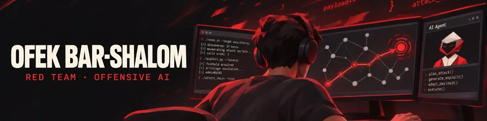

#  About Me:
Hi! I'm Ofek, an offensive security consultant at Sophtix and a B.Sc. Computer Science graduate specializing in cybersecurity. I’m passionate about red teaming, problem-solving, and offensive AI.  -  **Interests:**     - Red teaming and penetration testing     - Offensive AI and LLM security     - Adversarial ML research     -  **Looking to Collaborate On:**     - AI red teaming tools and agents     - AI security research on LLMs and VLMs     - Open-source security projects   

##  Socials:
   <a href="https://ofekbarshalom.github.io/">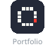</a>

#  Tech Stack:
**Offensive Security** 
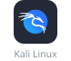    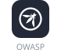 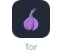

**AI & ML** 
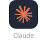   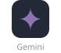  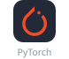 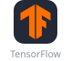 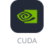  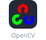 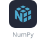 

**Backend & Cloud** 
 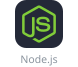   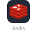   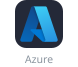

**Tools** 
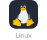 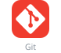 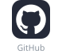  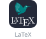

<!-- Proudly created with GPRM ( https://gprm.itsvg.in ) -->
